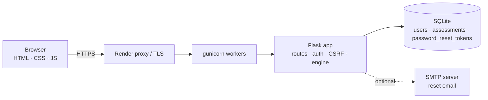

# Architecture Design Document — ReWorth

## Style
Server-rendered monolith: **Flask** (Jinja templates) + small vanilla-JS frontend calling one JSON endpoint, **SQLite** storage, served by **gunicorn** behind Render's HTTPS proxy.

## Layers
| Layer | Implementation |
|---|---|
| Presentation | `templates/*.html`, `static/css`, `static/js/app.js` (multi-step form, `fetch` to `/api/assess`) |
| Application | `app.py` routes: public pages, auth, account, assessment API, admin, health |
| Domain | `calculate_recommendation()` — transparent factor scoring (condition, function, cosmetic, age vs expected life, usage, problem type, repair history, repair-vs-replace economics, repairability) |
| Data | SQLite via `sqlite3`, parameterised queries, WAL mode, auto-migration in `init_db()` |

## API structure
| Method · Path | Purpose | Auth |
|---|---|---|
| GET `/` · `/assess` | Pages | public |
| POST `/api/assess` | Run engine, save if logged in | public + CSRF |
| POST `/register` · `/login` · GET `/logout` | Authentication | public |
| GET `/dashboard` · `/account` · `/account/export.csv` | User area | user |
| POST `/account/profile` · `/account/password` · `/account/delete` | Account management | user |
| GET/POST `/forgot-password` · `/reset-password/<token>` | Recovery | public |
| GET `/admin`, `/admin/users`, `/admin/export.csv` | Admin | admin |
| POST `/admin/users/<id>/role` · `/admin/users/<id>/reset-link` | Admin actions | admin |
| GET `/health` | Monitoring | public |

## Security architecture
CSRF token per session · `scrypt` password hashes · role check on every admin route · login/reset throttling · cookie flags (`HttpOnly`, `SameSite=Lax`, `Secure` in production) · HSTS/nosniff/frame-deny headers · request-size limit (64 KB) · input whitelist/length validation · CSV formula escaping · secrets from environment only · no default admin password in production.

## Configuration (environment variables)
`REWORTH_ENV`, `REWORTH_SECRET_KEY`, `REWORTH_ADMIN_EMAIL`, `REWORTH_ADMIN_PASSWORD`, `REWORTH_DB_PATH`, `REWORTH_DEMO_MODE`, `REWORTH_SMTP_*`.
