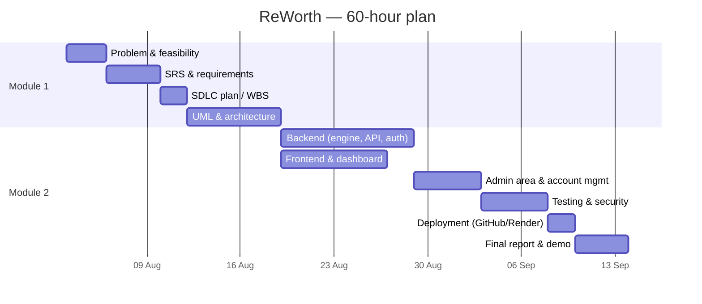

# SDLC Plan — ReWorth
**Model chosen: Iterative–Incremental (Agile-style, 1-week iterations).**
Reason: requirements were refined while building (engine v1 → v2, admin area, account management, hardened security). A small team and a fixed 60-hour budget suit short iterations with a working increment each time.

## Work Breakdown Structure (60 hours)
| # | Work package | Hours |
|---|---|---|
| 1 | Problem identification, stakeholders, feasibility | 4 |
| 2 | Requirements (SRS), prioritisation | 5 |
| 3 | SDLC plan, WBS, Gantt | 2 |
| 4 | UML modelling (use case, class, sequence, activity, ER, deployment) | 8 |
| 5 | Architecture & database design | 4 |
| 6 | Backend: engine, API, auth, admin | 14 |
| 7 | Frontend: pages, form flow, dashboard | 8 |
| 8 | Testing: unit, integration, security, load | 7 |
| 9 | Deployment (GitHub, CI, Render) | 3 |
| 10 | Final documentation, manual, presentation | 5 |
| | **Total** | **60** |

## Gantt chart

(Adjust the dates to your real semester calendar.)

## Resource plan
Developer laptop · Python 3.12, Flask, SQLite · VS Code · Git/GitHub · GitHub Actions (CI) · Render (hosting) · Playwright (screenshots).

## Risks
| Risk | Mitigation |
|---|---|
| Free hosting loses SQLite data on redeploy | Documented; optional persistent disk via `REWORTH_DB_PATH` |
| Credentials leaked in repo | Secrets only via environment variables; `.env` ignored |
| Scope creep | Out-of-scope list in SRS |
