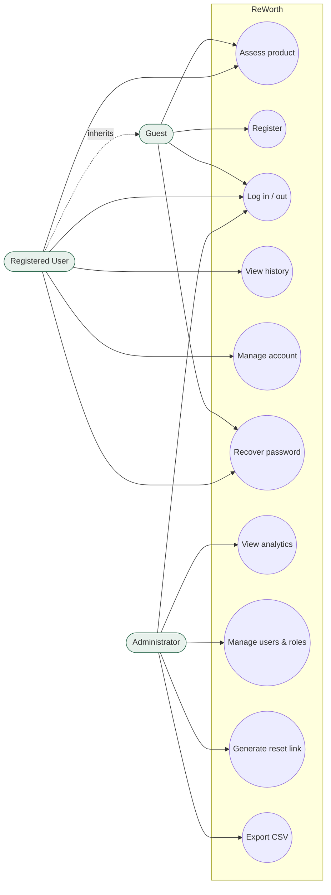
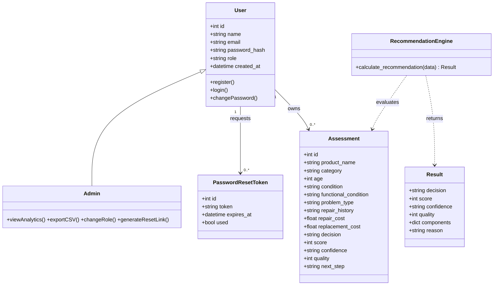
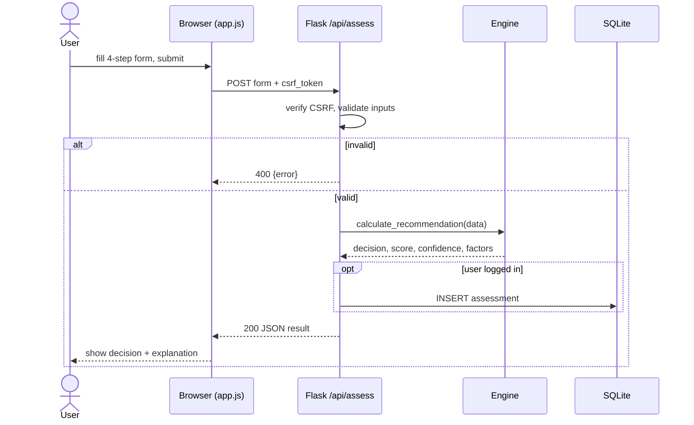
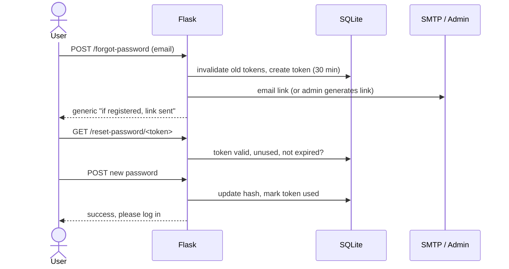
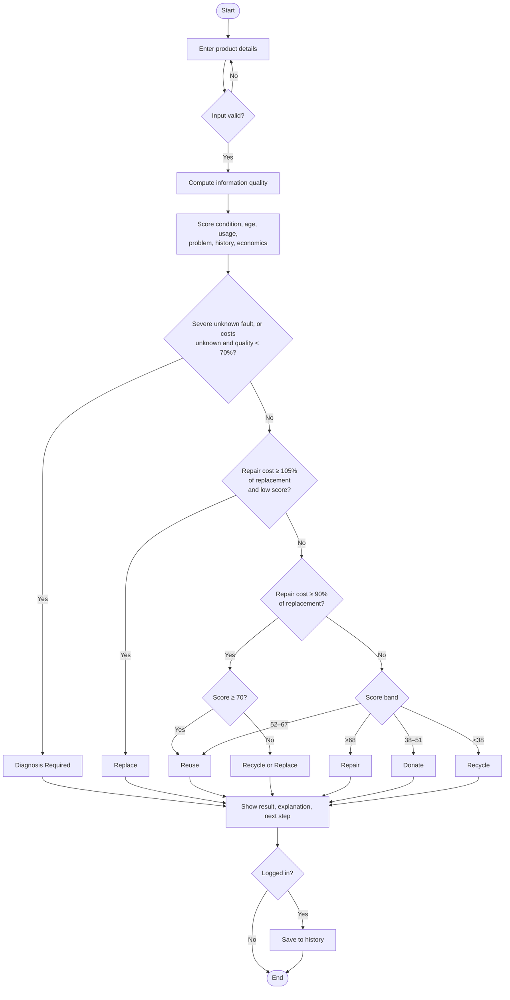
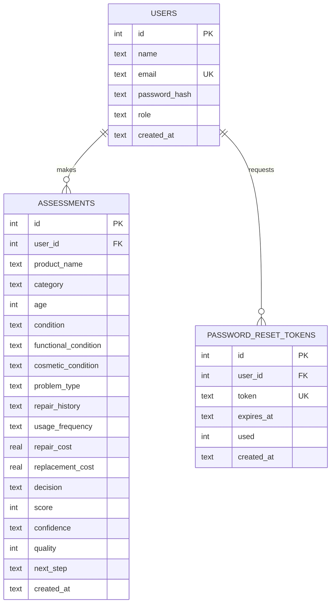
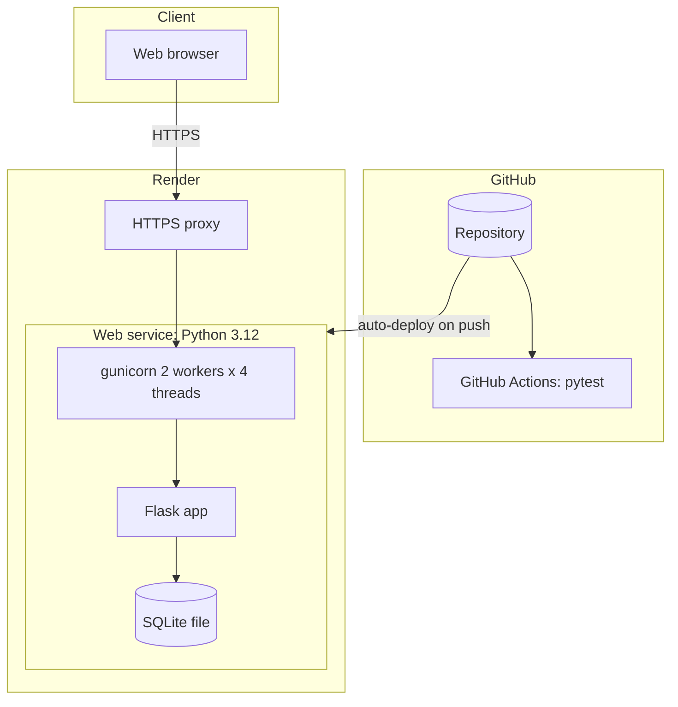

# UML Diagrams — ReWorth
All diagrams are Mermaid and render directly on GitHub.

## 1. Use case diagram

## 2. Class diagram

## 3. Sequence diagram — assess a product

## 4. Sequence diagram — password recovery (production)

## 5. Activity diagram — assessment decision flow

## 6. ER diagram

## 7. Deployment diagram

