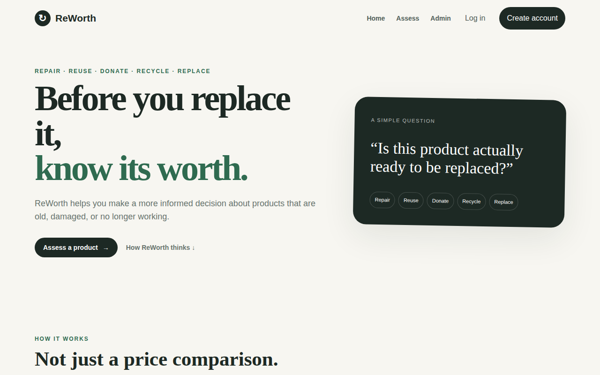
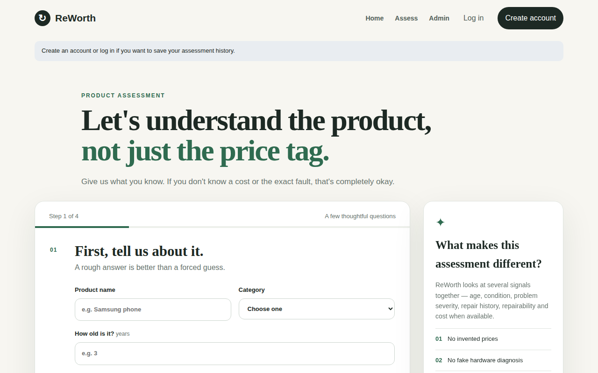
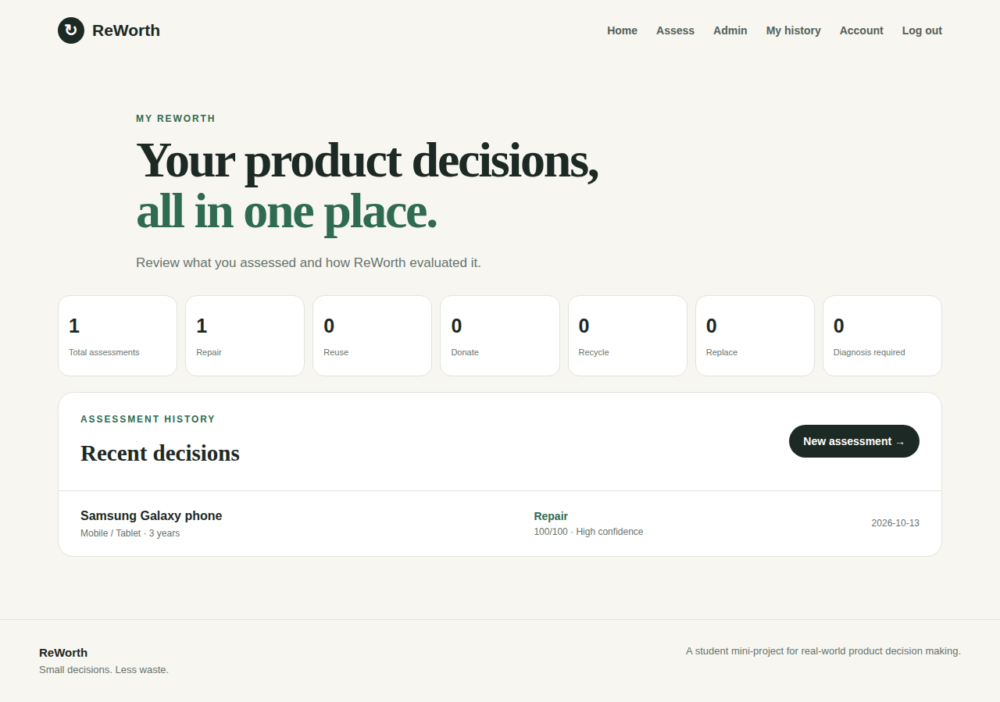
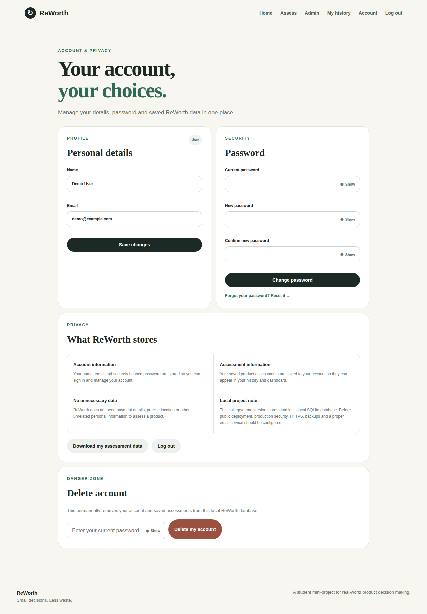
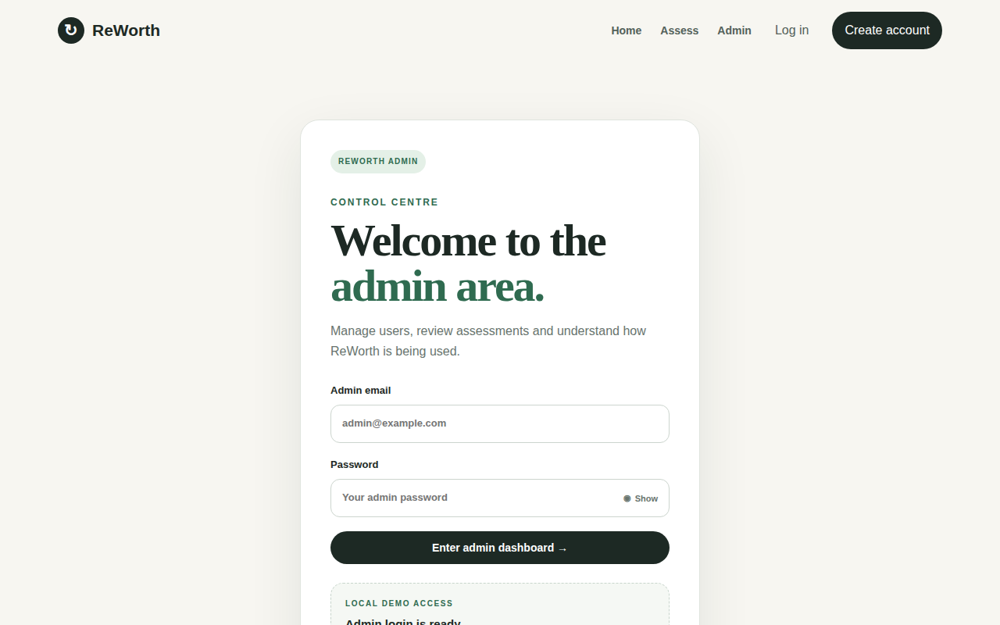
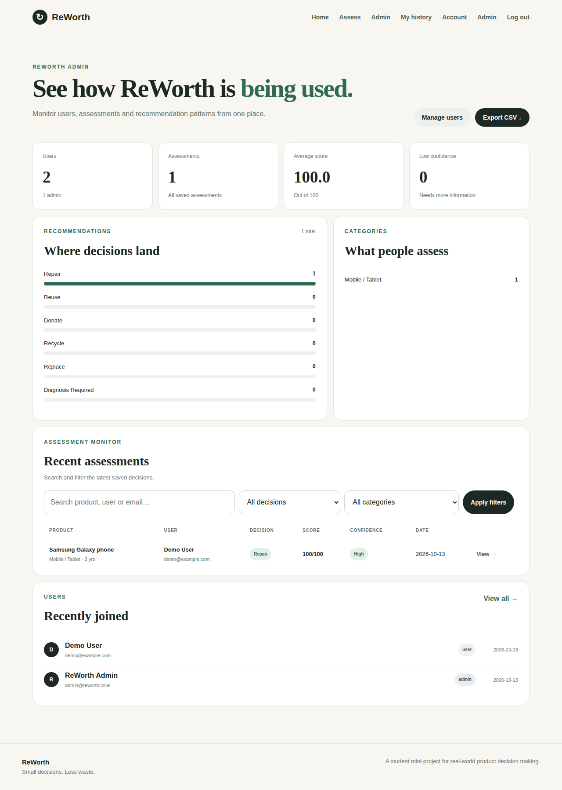
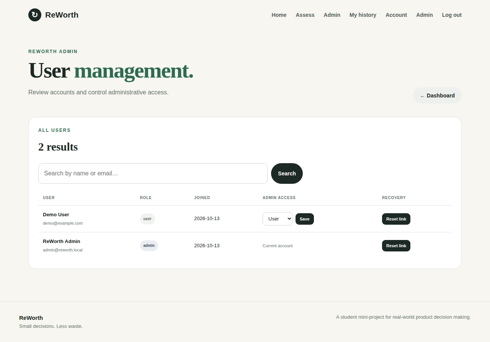
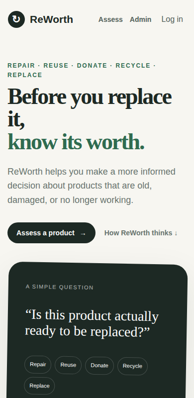

# User Manual — ReWorth

## For everyone
1. Open the site and click **Assess**.
2. Complete the four steps: **product** (name, category, age) → **condition** (overall, how it works, appearance) → **problem** (what is wrong, repair history, usage, missing parts) → **costs** (repair estimate and replacement price — both optional).
3. Submit. You see the **decision**, a **score**, **confidence**, how complete your information was, the **factors** behind the result and a **next step**.
   - *Diagnosis Required* means ReWorth needs more information; add details or get a repair estimate and try again.
4. Recommendations are guidance, not a technical diagnosis.

## Registered users
- **Create an account** from the home page (name, email, password of 8+ characters). Your assessments are then saved.
- **My history** shows totals per decision and each past assessment.
- **Account**: edit name/email, change password, download your history (CSV), delete your account.
- **Forgot password?** Use the link on the login box. Follow the emailed link (valid 30 min, single use) or ask the administrator for one.

## Administrators
Log in at **/admin/login**. See [ADMIN_GUIDE.md](ADMIN_GUIDE.md): dashboard statistics, filter/search assessments, export CSV, manage users and roles, and **generate a password-reset link** for a user.

## Screenshots
| | |
|---|---|
|  |  |
|  |  |
|  |  |
|  |  |
